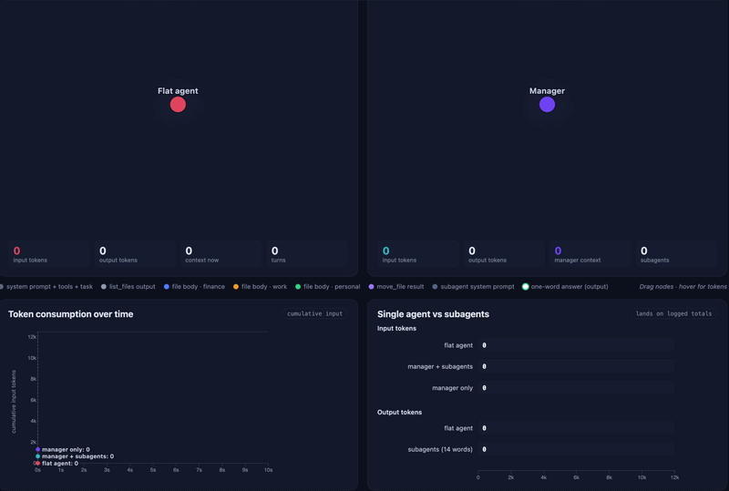

# Demo: Single agent vs Manager + Subagents

A React + D3 visualisation of the Sortly **P3** experiment. The same job (sort 14 loose files into `finance` / `work` / `personal`) is run two ways:


The page plays a **10-second animation of two trees** that grow as each run progresses. Below them, charts compare token consumption live and end exactly on the logged totals.

```
                     input tokens   output tokens   manager context
single agent              11,928           3,256            11,928
manager + subagents        2,062              56                86
```

---

## Running the demo

**Option A: Vite dev server** (Node.js 18 or later)

```powershell
npm install        # first time only
npm run dev        # opens http://localhost:5173
```

You can also double-click `start.bat`. It installs the dependencies if they're missing, then starts the dev server.

**Option B: no install.** Open `standalone.html` in a browser. It loads React, ReactDOM, D3 and Babel from cdnjs, so it needs internet access.
After you change anything in `src/`, run `python build_standalone.py` to rebuild it.

**Controls:** ▶ Play / ❚❚ Pause / ↺ Reset. You can drag tree nodes, and hovering a node shows a tooltip with its tokens.

---

## How the data drives the animation (`src/data.js`)

Each tree comes from an **event stream**: a time-sorted array in which each event adds one node.

```js
{ t, id, parent, kind, tok, io, label?, cat?, tip, doneAt? }
//  t      ms on the 0–10,000 timeline when the node appears
//  parent id of the parent node (null for the root)
//  kind   agent | turn | manager | subagent | base | list | move | system | word | finance | work | personal
//  tok    tokens the node represents (drives its size)
//  io     "in" | "out" | null: which ledger the tokens count toward
//  doneAt (subagents only) when the subagent answers and its context is discarded
```

| Export                                  | Purpose                                                                                                                                              |
| --------------------------------------- | ---------------------------------------------------------------------------------------------------------------------------------------------------- |
| `FILES`, `RUN`, `MODELS`                | Values copied from the run logs (file names, chars, categories, final ledgers)                                                                       |
| `FLAT_EVENTS`                           | agent → `turn 1…4` → what each turn sends. Turns 3 and 4 **resend** the base prompt, the listing and all 14 file bodies; turn 4 adds 14 move results |
| `SUB_EVENTS`                            | manager → listing (86 tok) + 14 subagents → each with `system` (~90 tok), file snippet (chars / 4) and a one-word `word` answer (4 output tok)       |
| `tokensAt(events, ms)` / `ledgerAt(ms)` | Sum the `in`/`out` tokens of every node visible at time _ms_                                                                                         |
| `SERIES`                                | `ledgerAt` sampled every 50 ms, used by the timeline chart                                                                                           |
| `nodeRadius(e)`                         | Fixed radii for structural nodes; `√tok × 0.5` for leaves, so **area ∝ tokens**                                                                      |
| `DURATION`                              | 10,000 ms                                                                                                                                            |

**About the numbers:** totals match the logs exactly. The logs don't show how tokens split across individual nodes, so the split is an estimate:
the flat agent uses `4·2052 + 3·140 + 2·1300 + 14·50 = 11,928`, and each subagent uses `90.2 + chars/4`, which over 14 calls gives `1,976`.

---

## How `ForceTree.jsx` is implemented

The component follows Observable's [Force-directed tree](https://observablehq.com/@d3/force-directed-tree) example: a `d3.forceSimulation` with link, many-body and x/y centring forces, plus drag.
It extends the example in three ways: nodes **arrive over time**, nodes are **sized by tokens**, and finished subagents are **dimmed**.

```jsx
<ForceTree events={FLAT_EVENTS} elapsed={elapsed} />
```

### 1. Ownership: React owns the `<svg>`, D3 owns everything inside it

React renders one empty `<svg ref={ref}>`. All drawing goes through D3 selections in `useEffect`. A `useRef` holds mutable state that must persist across renders without triggering re-renders:

```js
const st = useRef({ nodes: [], byId: new Map(), sim: null });
```

`nodes` must remain the **same objects** across updates. d3-force writes `x, y, vx, vy` onto them, so reusing them keeps the layout continuous.

### 2. Update effect (runs whenever `elapsed` changes)

1. **Visible set:** `events.filter(e => e.t <= elapsed)`.
2. **Reset detection:** if fewer events are visible than nodes exist (Reset or Replay), the node list is cleared.
3. **Add new nodes only:** for each new event, a node object is created at its parent's position plus a small random offset, so it appears to _sprout_ from the parent. It is stored in `nodes` and `byId`.
4. **Rebuild links** from the `parent` fields: `{ source: parentId, target: id }`.
5. **Re-feed the simulation:** `sim.nodes(nodes)` first, then `force("link").links(links)`, so string ids resolve to node objects. Then `alpha(0.55).restart()` reheats the layout so it settles around the new nodes.
6. **Data joins (keyed by id)**, so existing elements keep their DOM nodes and only new ones enter:
   - `line`: enters at `stroke-opacity 0` and transitions to 0.55.
   - `circle`: enters at `r = 0` and transitions to `d.r` with `easeBackOut` (a small "pop"). Fill comes from `COLORS[kind]`; one-word answers get a white fill with a category-coloured ring; it has a `<title>` tooltip and drag behaviour.
   - `text`: labels only for nodes that have a `label` (agent, turns, manager, `#1…#14`), which fade in.
7. **Discarded context:** for each subagent with `elapsed >= doneAt`, the subagent and its `system` and file leaves are dimmed to opacity 0.28. Its `word` leaf stays bright, because that answer is the only thing passed back to the manager.

Because d3 transitions and the force simulation do all the motion, React only re-renders when the clock changes. The effect returns early when no new events are visible.

### 3. Drag

`drag(simulation)` is the standard pattern: on start, reheat the simulation (`alphaTarget(0.3)`) and pin the node (`fx/fy`); while dragging, move the pin; on end, release it.

---

## Other components

- **`App.jsx`:** a `d3.timer` drives `elapsed` from 0 to 10,000 ms. Pause stores the offset and Resume continues from it. It passes `elapsed` to both trees and both charts, and shows live stats (`ledgerAt`) under each tree plus the final ledger table and ratios.
- **`Charts.jsx`:**
  - `TokenTimeline`: cumulative input tokens for single agent, manager + subagents, and manager only. The full step-curves are drawn once; a `clipPath` rectangle reveals them up to `elapsed`, and the labels follow a cursor.
  - `TokenBars`: input and output bars whose widths track `ledgerAt(elapsed)` and land on the logged totals.
  - `AnimatedNumber`: tweens numeric text with a d3 transition.

---

## What to take away

- The flat agent's tree keeps **duplicating** the same file bodies, because every turn resends the whole context. The manager's own context stays at **86 tokens** however many files there are.
- Delegation is **not automatically cheaper**. About 90 of each subagent's ~141 input tokens are its own system prompt. What it reliably buys is a manager context that doesn't grow with the job, a cheaper model for each subtask, and subtasks that can run in parallel.
- One file was classified differently: `rent_receipt_july.txt` went to `finance` in the flat run and `personal` in the subagent run. Subagent output should still be validated.
